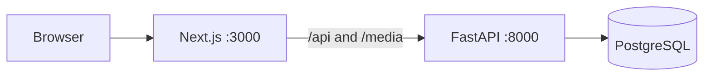

# Architecture

Bazaar is one modular application, not a set of services. The Next.js app is the only thing a browser talks to. It forwards `/api` and `/media` to FastAPI, so the login cookie, the store, and Swagger share one origin.

The API process connects as `bazaar_app`. That role cannot bypass row-level security and cannot update or delete the audit log, commission lines, or ledger. Migrations and the demo seed run as `bazaar_owner`.

Each request sets `app.scope`, `app.user_id`, and `app.vendor_id` for the transaction. Policies on products, orders, payouts, coupons, carts, and wishlists read those settings. A vendor who asks for another shop's row gets an empty result, and the service returns 404.

Money is integer cents. Commission rates are basis points. A successful create, update, or delete writes an audit row in the same transaction as the change.

## Decision records

### Modular monolith

The ten modules are routers and services in one process. A marketplace checkout has to reserve stock, split a payment, freeze commission, and write the ledger together. A network call between those steps would make the failure modes worse than the course needs.

### Postgres row-level security

Application filters are easy to forget. The database role used by the API is not a superuser and does not have `BYPASSRLS`, so a query that omits a vendor id still cannot return another shop's rows. Cross-tenant reads are tested with SQL, not only with HTTP.

### Integer cents

Prices, shipping, discounts, commission, and the ledger are integers. A platform coupon is split with largest remainder so the parts add up to the coupon. The research example that paid `$100` after a `$10` coupon is wrong; the customer pays `$90`.

### Append-only audit

`bazaar_app` may insert and select `audit_logs`. Clearing the hot log is a `SECURITY DEFINER` function, Super Admin only, and the archive call is itself audited. The app role cannot `UPDATE` or `DELETE` the table.

### Next.js as the only public origin

Other computers open port 3000. Swagger is `/api/docs` on that same origin. Cookie sessions send `X-Bazaar-Client` so a random site cannot reuse the cookie.
