# Entity diagram

Generated from the SQLAlchemy models. Regenerate with `uv run python scripts/gen_docs.py`.

```mermaid
erDiagram
  audit_logs {
    BIGINT id PK
    DATETIME at
    VARCHAR actor_id
    VARCHAR actor_name
    JSONB actor_roles
    VARCHAR actor_vendor_id
    VARCHAR ip
    VARCHAR user_agent
    VARCHAR module
    VARCHAR action
    VARCHAR resource_type
    VARCHAR resource_id
    JSONB before
    JSONB after
    VARCHAR request_id
    VARCHAR outcome
    VARCHAR reason
  }
  audit_logs_archive {
    BIGINT id PK
    DATETIME archived_at
    DATETIME at
    VARCHAR actor_id
    VARCHAR actor_name
    JSONB actor_roles
    VARCHAR actor_vendor_id
    VARCHAR ip
    VARCHAR user_agent
    VARCHAR module
    VARCHAR action
    VARCHAR resource_type
    VARCHAR resource_id
    JSONB before
    JSONB after
    VARCHAR request_id
    VARCHAR outcome
    VARCHAR reason
  }
  categories {
    VARCHAR id PK
    VARCHAR name
    VARCHAR name_kh
    VARCHAR slug
    VARCHAR parent_id
    INTEGER sort
    DATETIME created_at
  }
  commission_rules {
    VARCHAR id PK
    VARCHAR name
    VARCHAR target_type
    VARCHAR target_id
    INTEGER rate_bps
    INTEGER min_fee_cents
    VARCHAR applies_to
    INTEGER version
    VARCHAR supersedes_id
    DATETIME effective_from
    DATETIME effective_to
    VARCHAR created_by
    DATETIME created_at
  }
  commission_tiers {
    VARCHAR id PK
    VARCHAR name
    VARCHAR name_kh
    BIGINT min_sales
    BIGINT max_sales
    INTEGER sort
  }
  outbox_events {
    VARCHAR id PK
    VARCHAR event_type
    JSONB payload
    DATETIME created_at
    DATETIME processed_at
  }
  permissions {
    VARCHAR key PK
    VARCHAR module
    VARCHAR action
    VARCHAR description
    INTEGER sort
  }
  roles {
    VARCHAR id PK
    VARCHAR name
    VARCHAR description
    VARCHAR kind
    BOOLEAN is_system
    BOOLEAN is_locked
    VARCHAR parent_id
    DATETIME created_at
  }
  tags {
    VARCHAR id PK
    VARCHAR name
    VARCHAR slug
  }
  warehouses {
    VARCHAR id PK
    VARCHAR name
    VARCHAR city
  }
  role_permissions {
    VARCHAR role_id PK
    VARCHAR permission_key PK
    DATETIME granted_at
    VARCHAR granted_by
  }
  vendors {
    VARCHAR id PK
    VARCHAR name
    VARCHAR slug
    VARCHAR country
    VARCHAR city
    VARCHAR status
    VARCHAR status_reason
    DATETIME verified_at
    VARCHAR tier_id
    VARCHAR warehouse_id
    VARCHAR headline
    TEXT about
    VARCHAR image_url
    INTEGER hue
    INTEGER shipping_fee_cents
    INTEGER processing_days
    BIGINT lifetime_sales
    NUMERIC rating
    VARCHAR rating_flag
    INTEGER review_count
    DATE since
    INTEGER response_hours
    VARCHAR response_flag
    VARCHAR catalog_size
    BOOLEAN is_outlier
    VARCHAR payout_account
    TEXT internal_notes
    DATETIME deleted_at
    DATETIME created_at
    DATETIME updated_at
  }
  coupons {
    VARCHAR code PK
    VARCHAR funded_by
    VARCHAR vendor_id
    VARCHAR discount_type
    INTEGER percent_off
    INTEGER amount_off_cents
    INTEGER min_subtotal_cents
    DATETIME starts_at
    DATETIME ends_at
    INTEGER usage_limit
    INTEGER per_customer_limit
    INTEGER used_count
    BOOLEAN is_flash
    BOOLEAN active
    VARCHAR note
    VARCHAR created_by
    DATETIME created_at
    DATETIME updated_at
  }
  ledger_entries {
    BIGINT id PK
    VARCHAR journal_id
    VARCHAR account
    VARCHAR vendor_id
    INTEGER debit_cents
    INTEGER credit_cents
    VARCHAR order_id
    VARCHAR sub_order_id
    VARCHAR payout_id
    VARCHAR memo
    DATETIME created_at
  }
  payouts {
    VARCHAR id PK
    VARCHAR vendor_id
    INTEGER amount_cents
    VARCHAR status
    VARCHAR held_from_status
    VARCHAR note
    VARCHAR reference
    VARCHAR requested_by
    DATETIME requested_at
    DATETIME approved_at
    DATETIME paid_at
    DATETIME created_at
  }
  products {
    VARCHAR id PK
    VARCHAR vendor_id
    VARCHAR category_id
    VARCHAR title
    TEXT description
    INTEGER price_cents
    INTEGER low_stock_threshold
    VARCHAR image_url
    BOOLEAN active
    DATETIME archived_at
    DATETIME created_at
    DATETIME updated_at
  }
  users {
    VARCHAR id PK
    VARCHAR email
    VARCHAR password_hash
    VARCHAR name
    VARCHAR blurb
    VARCHAR blurb_kh
    VARCHAR city
    VARCHAR source
    VARCHAR avatar_url
    VARCHAR vendor_id
    BOOLEAN is_active
    DATETIME banned_at
    VARCHAR ban_reason
    DATETIME created_at
    DATETIME last_login_at
  }
  vendor_documents {
    VARCHAR id PK
    VARCHAR vendor_id
    VARCHAR kind
    VARCHAR name
    VARCHAR status
    VARCHAR file_path
    VARCHAR original_filename
    VARCHAR content_type
    DATETIME uploaded_at
    VARCHAR reviewed_by
    DATETIME reviewed_at
  }
  vendor_status_events {
    BIGINT id PK
    VARCHAR vendor_id
    VARCHAR from_status
    VARCHAR to_status
    VARCHAR actor_id
    VARCHAR reason
    DATETIME at
  }
  carts {
    VARCHAR id PK
    VARCHAR user_id
    VARCHAR coupon_code
    DATETIME updated_at
  }
  notifications {
    VARCHAR id PK
    VARCHAR user_id
    VARCHAR kind
    VARCHAR title
    TEXT body
    VARCHAR link
    DATETIME read_at
    DATETIME created_at
  }
  payment_intents {
    VARCHAR id PK
    VARCHAR user_id
    VARCHAR status
    INTEGER amount_cents
    VARCHAR currency
    VARCHAR coupon_code
    VARCHAR ship_name
    VARCHAR ship_address
    JSONB quote
    VARCHAR order_id
    VARCHAR card_last4
    VARCHAR failure_reason
    DATETIME created_at
    DATETIME expires_at
    DATETIME confirmed_at
  }
  payout_approvals {
    VARCHAR payout_id PK
    VARCHAR approver_id PK
    VARCHAR approver_name
    JSONB approver_roles
    DATETIME at
  }
  payout_events {
    BIGINT id PK
    VARCHAR payout_id
    VARCHAR from_status
    VARCHAR to_status
    VARCHAR actor_id
    VARCHAR note
    DATETIME at
  }
  product_tags {
    VARCHAR product_id PK
    VARCHAR tag_id PK
  }
  user_roles {
    VARCHAR user_id PK
    VARCHAR role_id PK
    DATETIME assigned_at
    VARCHAR assigned_by
  }
  variants {
    VARCHAR id PK
    VARCHAR product_id
    VARCHAR vendor_id
    VARCHAR sku
    VARCHAR size
    VARCHAR color
    BOOLEAN active
    DATETIME created_at
  }
  wishlist_items {
    VARCHAR user_id PK
    VARCHAR product_id PK
    DATETIME created_at
  }
  cart_lines {
    BIGINT id PK
    VARCHAR cart_id
    VARCHAR variant_id
    INTEGER qty
    DATETIME added_at
  }
  orders {
    VARCHAR id PK
    VARCHAR buyer_id
    VARCHAR payment_intent_id
    VARCHAR status
    INTEGER items_subtotal_cents
    INTEGER shipping_cents
    INTEGER discount_cents
    INTEGER platform_discount_cents
    INTEGER vendor_discount_cents
    INTEGER total_cents
    INTEGER refunded_cents
    VARCHAR coupon_code
    VARCHAR source
    VARCHAR ship_name
    VARCHAR ship_address
    VARCHAR card_last4
    DATETIME placed_at
    DATETIME completed_at
  }
  stock_items {
    BIGINT id PK
    VARCHAR variant_id
    VARCHAR vendor_id
    VARCHAR warehouse_id
    INTEGER on_hand
    INTEGER reserved
    DATETIME updated_at
  }
  conversations {
    VARCHAR id PK
    VARCHAR buyer_id
    VARCHAR vendor_id
    VARCHAR order_id
    VARCHAR subject
    DATETIME last_message_at
    VARCHAR last_sender_role
    INTEGER message_count
    DATETIME created_at
  }
  coupon_redemptions {
    BIGINT id PK
    VARCHAR coupon_code
    VARCHAR customer_id
    VARCHAR order_id
    INTEGER discount_cents
    DATETIME at
  }
  stock_reservations {
    BIGINT id PK
    VARCHAR payment_intent_id
    BIGINT stock_item_id
    VARCHAR variant_id
    INTEGER qty
    VARCHAR status
    DATETIME expires_at
    DATETIME created_at
  }
  sub_orders {
    VARCHAR id PK
    VARCHAR order_id
    VARCHAR vendor_id
    VARCHAR buyer_id
    VARCHAR status
    INTEGER items_subtotal_cents
    INTEGER shipping_cents
    INTEGER vendor_discount_cents
    INTEGER platform_discount_cents
    INTEGER charged_cents
    INTEGER commission_cents
    INTEGER vendor_net_cents
    INTEGER refunded_cents
    VARCHAR tracking_number
    VARCHAR carrier
    VARCHAR warehouse_id
    BOOLEAN in_dispute
    DATETIME accepted_at
    DATETIME shipped_at
    DATETIME delivered_at
    DATETIME cancelled_at
    DATETIME created_at
  }
  conversation_messages {
    VARCHAR id PK
    VARCHAR conversation_id
    VARCHAR buyer_id
    VARCHAR vendor_id
    VARCHAR sender_id
    VARCHAR sender_name
    VARCHAR sender_role
    TEXT body
    DATETIME at
  }
  disputes {
    VARCHAR id PK
    VARCHAR order_id
    VARCHAR sub_order_id
    VARCHAR buyer_id
    VARCHAR vendor_id
    VARCHAR reason
    TEXT note
    VARCHAR status
    TEXT resolution_note
    VARCHAR resolved_by
    DATETIME resolved_at
    DATETIME created_at
  }
  order_lines {
    BIGINT id PK
    VARCHAR sub_order_id
    VARCHAR order_id
    VARCHAR vendor_id
    VARCHAR buyer_id
    VARCHAR product_id
    VARCHAR variant_id
    VARCHAR category_id
    VARCHAR title
    VARCHAR sku
    VARCHAR size
    VARCHAR color
    VARCHAR image_url
    INTEGER unit_price_cents
    INTEGER qty
    INTEGER line_total_cents
    INTEGER vendor_discount_cents
    INTEGER platform_discount_cents
  }
  payout_items {
    BIGINT id PK
    VARCHAR payout_id
    VARCHAR vendor_id
    VARCHAR sub_order_id
    INTEGER amount_cents
  }
  reviews {
    VARCHAR id PK
    VARCHAR product_id
    VARCHAR vendor_id
    VARCHAR buyer_id
    VARCHAR sub_order_id
    NUMERIC rating
    TEXT body
    VARCHAR sentiment
    VARCHAR theme
    VARCHAR source
    VARCHAR status
    VARCHAR moderation_reason
    TEXT vendor_response
    DATETIME vendor_responded_at
    DATETIME created_at
  }
  sub_order_events {
    BIGINT id PK
    VARCHAR sub_order_id
    VARCHAR from_status
    VARCHAR to_status
    VARCHAR actor_id
    VARCHAR actor_role
    TEXT note
    DATETIME at
  }
  commission_lines {
    BIGINT id PK
    BIGINT order_line_id
    VARCHAR sub_order_id
    VARCHAR order_id
    VARCHAR vendor_id
    VARCHAR rule_id
    INTEGER rule_version
    VARCHAR rule_target
    INTEGER rate_bps
    INTEGER min_fee_cents
    INTEGER base_cents
    INTEGER fee_cents
    DATETIME computed_at
  }
  review_events {
    BIGINT id PK
    VARCHAR review_id
    VARCHAR from_status
    VARCHAR to_status
    VARCHAR actor_id
    VARCHAR reason
    DATETIME at
  }
  categories ||--o{ categories : parent_id
  commission_rules ||--o{ commission_rules : supersedes_id
  roles ||--o{ roles : parent_id
  permissions ||--o{ role_permissions : permission_key
  roles ||--o{ role_permissions : role_id
  commission_tiers ||--o{ vendors : tier_id
  warehouses ||--o{ vendors : warehouse_id
  vendors ||--o{ coupons : vendor_id
  vendors ||--o{ ledger_entries : vendor_id
  vendors ||--o{ payouts : vendor_id
  categories ||--o{ products : category_id
  vendors ||--o{ products : vendor_id
  vendors ||--o{ users : vendor_id
  vendors ||--o{ vendor_documents : vendor_id
  vendors ||--o{ vendor_status_events : vendor_id
  users ||--o{ carts : user_id
  users ||--o{ notifications : user_id
  users ||--o{ payment_intents : user_id
  payouts ||--o{ payout_approvals : payout_id
  users ||--o{ payout_approvals : approver_id
  payouts ||--o{ payout_events : payout_id
  tags ||--o{ product_tags : tag_id
  products ||--o{ product_tags : product_id
  users ||--o{ user_roles : user_id
  roles ||--o{ user_roles : role_id
  vendors ||--o{ variants : vendor_id
  products ||--o{ variants : product_id
  products ||--o{ wishlist_items : product_id
  users ||--o{ wishlist_items : user_id
  carts ||--o{ cart_lines : cart_id
  variants ||--o{ cart_lines : variant_id
  payment_intents ||--o{ orders : payment_intent_id
  users ||--o{ orders : buyer_id
  warehouses ||--o{ stock_items : warehouse_id
  vendors ||--o{ stock_items : vendor_id
  variants ||--o{ stock_items : variant_id
  vendors ||--o{ conversations : vendor_id
  orders ||--o{ conversations : order_id
  users ||--o{ conversations : buyer_id
  orders ||--o{ coupon_redemptions : order_id
  users ||--o{ coupon_redemptions : customer_id
  coupons ||--o{ coupon_redemptions : coupon_code
  payment_intents ||--o{ stock_reservations : payment_intent_id
  stock_items ||--o{ stock_reservations : stock_item_id
  orders ||--o{ sub_orders : order_id
  vendors ||--o{ sub_orders : vendor_id
  users ||--o{ sub_orders : buyer_id
  warehouses ||--o{ sub_orders : warehouse_id
  conversations ||--o{ conversation_messages : conversation_id
  vendors ||--o{ disputes : vendor_id
  orders ||--o{ disputes : order_id
  sub_orders ||--o{ disputes : sub_order_id
  users ||--o{ disputes : buyer_id
  orders ||--o{ order_lines : order_id
  variants ||--o{ order_lines : variant_id
  products ||--o{ order_lines : product_id
  sub_orders ||--o{ order_lines : sub_order_id
  vendors ||--o{ order_lines : vendor_id
  vendors ||--o{ payout_items : vendor_id
  payouts ||--o{ payout_items : payout_id
  sub_orders ||--o{ payout_items : sub_order_id
  users ||--o{ reviews : buyer_id
  vendors ||--o{ reviews : vendor_id
  sub_orders ||--o{ reviews : sub_order_id
  products ||--o{ reviews : product_id
  sub_orders ||--o{ sub_order_events : sub_order_id
  order_lines ||--o{ commission_lines : order_line_id
  vendors ||--o{ commission_lines : vendor_id
  commission_rules ||--o{ commission_lines : rule_id
  orders ||--o{ commission_lines : order_id
  sub_orders ||--o{ commission_lines : sub_order_id
  reviews ||--o{ review_events : review_id
```

## Tables

- `audit_logs`: id, at, actor_id, actor_name, actor_roles, actor_vendor_id, ip, user_agent, module, action, resource_type, resource_id, before, after, request_id, outcome, reason
- `audit_logs_archive`: id, archived_at, at, actor_id, actor_name, actor_roles, actor_vendor_id, ip, user_agent, module, action, resource_type, resource_id, before, after, request_id, outcome, reason
- `categories`: id, name, name_kh, slug, parent_id, sort, created_at
- `commission_rules`: id, name, target_type, target_id, rate_bps, min_fee_cents, applies_to, version, supersedes_id, effective_from, effective_to, created_by, created_at
- `commission_tiers`: id, name, name_kh, min_sales, max_sales, sort
- `outbox_events`: id, event_type, payload, created_at, processed_at
- `permissions`: key, module, action, description, sort
- `roles`: id, name, description, kind, is_system, is_locked, parent_id, created_at
- `tags`: id, name, slug
- `warehouses`: id, name, city
- `role_permissions`: role_id, permission_key, granted_at, granted_by
- `vendors`: id, name, slug, country, city, status, status_reason, verified_at, tier_id, warehouse_id, headline, about, image_url, hue, shipping_fee_cents, processing_days, lifetime_sales, rating, rating_flag, review_count, since, response_hours, response_flag, catalog_size, is_outlier, payout_account, internal_notes, deleted_at, created_at, updated_at
- `coupons`: code, funded_by, vendor_id, discount_type, percent_off, amount_off_cents, min_subtotal_cents, starts_at, ends_at, usage_limit, per_customer_limit, used_count, is_flash, active, note, created_by, created_at, updated_at
- `ledger_entries`: id, journal_id, account, vendor_id, debit_cents, credit_cents, order_id, sub_order_id, payout_id, memo, created_at
- `payouts`: id, vendor_id, amount_cents, status, held_from_status, note, reference, requested_by, requested_at, approved_at, paid_at, created_at
- `products`: id, vendor_id, category_id, title, description, price_cents, low_stock_threshold, image_url, active, archived_at, created_at, updated_at
- `users`: id, email, password_hash, name, blurb, blurb_kh, city, source, avatar_url, vendor_id, is_active, banned_at, ban_reason, created_at, last_login_at
- `vendor_documents`: id, vendor_id, kind, name, status, file_path, original_filename, content_type, uploaded_at, reviewed_by, reviewed_at
- `vendor_status_events`: id, vendor_id, from_status, to_status, actor_id, reason, at
- `carts`: id, user_id, coupon_code, updated_at
- `notifications`: id, user_id, kind, title, body, link, read_at, created_at
- `payment_intents`: id, user_id, status, amount_cents, currency, coupon_code, ship_name, ship_address, quote, order_id, card_last4, failure_reason, created_at, expires_at, confirmed_at
- `payout_approvals`: payout_id, approver_id, approver_name, approver_roles, at
- `payout_events`: id, payout_id, from_status, to_status, actor_id, note, at
- `product_tags`: product_id, tag_id
- `user_roles`: user_id, role_id, assigned_at, assigned_by
- `variants`: id, product_id, vendor_id, sku, size, color, active, created_at
- `wishlist_items`: user_id, product_id, created_at
- `cart_lines`: id, cart_id, variant_id, qty, added_at
- `orders`: id, buyer_id, payment_intent_id, status, items_subtotal_cents, shipping_cents, discount_cents, platform_discount_cents, vendor_discount_cents, total_cents, refunded_cents, coupon_code, source, ship_name, ship_address, card_last4, placed_at, completed_at
- `stock_items`: id, variant_id, vendor_id, warehouse_id, on_hand, reserved, updated_at
- `conversations`: id, buyer_id, vendor_id, order_id, subject, last_message_at, last_sender_role, message_count, created_at
- `coupon_redemptions`: id, coupon_code, customer_id, order_id, discount_cents, at
- `stock_reservations`: id, payment_intent_id, stock_item_id, variant_id, qty, status, expires_at, created_at
- `sub_orders`: id, order_id, vendor_id, buyer_id, status, items_subtotal_cents, shipping_cents, vendor_discount_cents, platform_discount_cents, charged_cents, commission_cents, vendor_net_cents, refunded_cents, tracking_number, carrier, warehouse_id, in_dispute, accepted_at, shipped_at, delivered_at, cancelled_at, created_at
- `conversation_messages`: id, conversation_id, buyer_id, vendor_id, sender_id, sender_name, sender_role, body, at
- `disputes`: id, order_id, sub_order_id, buyer_id, vendor_id, reason, note, status, resolution_note, resolved_by, resolved_at, created_at
- `order_lines`: id, sub_order_id, order_id, vendor_id, buyer_id, product_id, variant_id, category_id, title, sku, size, color, image_url, unit_price_cents, qty, line_total_cents, vendor_discount_cents, platform_discount_cents
- `payout_items`: id, payout_id, vendor_id, sub_order_id, amount_cents
- `reviews`: id, product_id, vendor_id, buyer_id, sub_order_id, rating, body, sentiment, theme, source, status, moderation_reason, vendor_response, vendor_responded_at, created_at
- `sub_order_events`: id, sub_order_id, from_status, to_status, actor_id, actor_role, note, at
- `commission_lines`: id, order_line_id, sub_order_id, order_id, vendor_id, rule_id, rule_version, rule_target, rate_bps, min_fee_cents, base_cents, fee_cents, computed_at
- `review_events`: id, review_id, from_status, to_status, actor_id, reason, at
