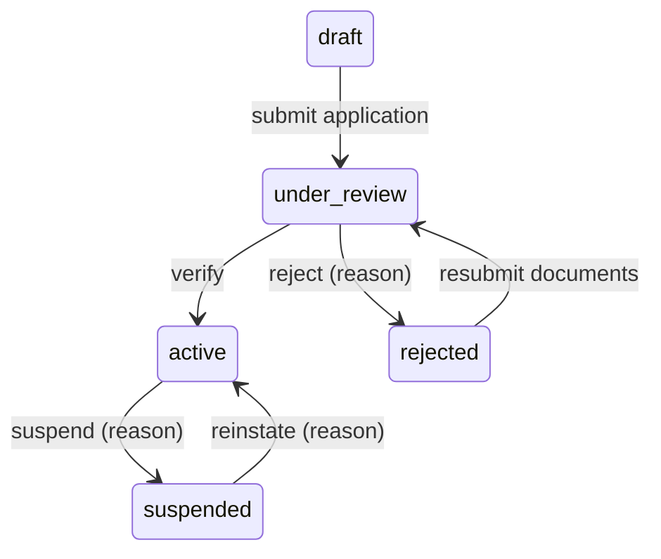
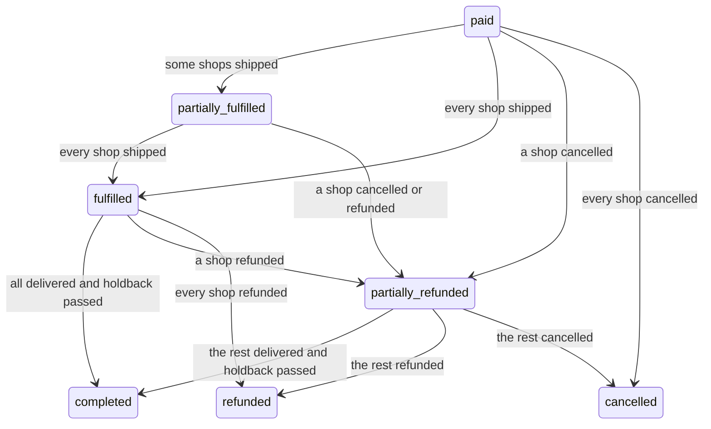
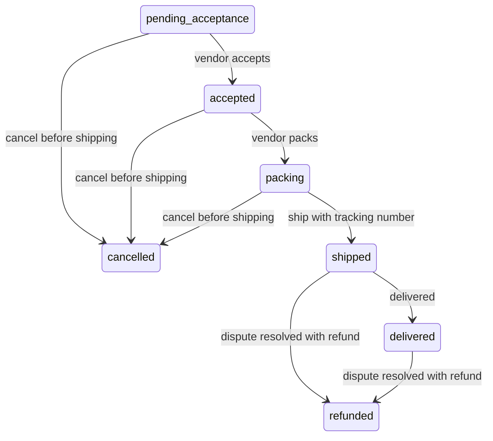
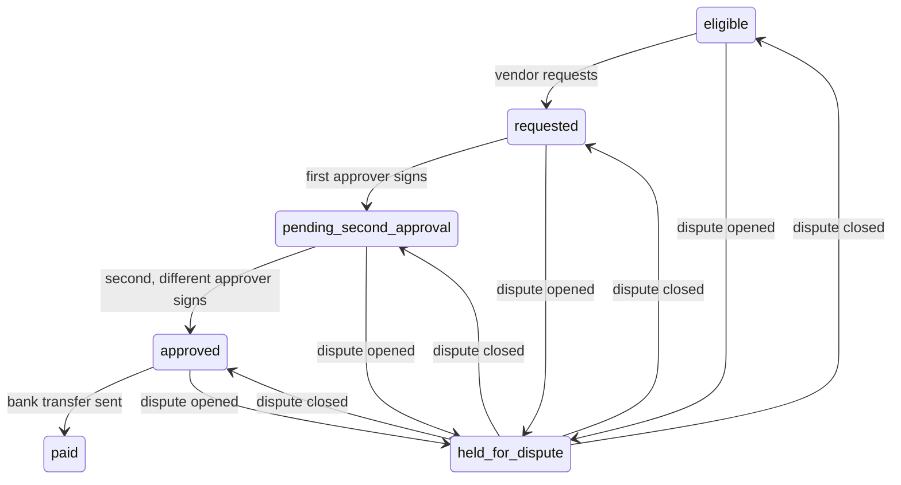
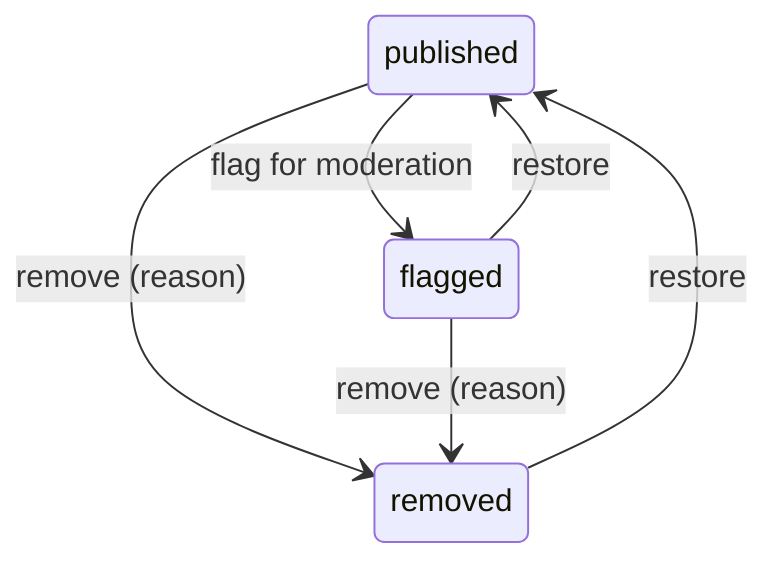
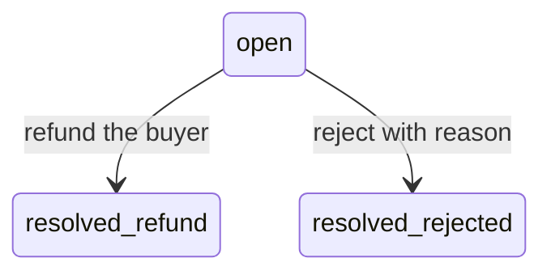

# State machines

Generated from `app/domain/states.py`. A transition that is not listed returns 409.

Terminal: none.

Terminal: cancelled, completed, refunded.

Terminal: cancelled, refunded.

Terminal: paid.

Terminal: none.

Terminal: resolved_refund, resolved_rejected.
