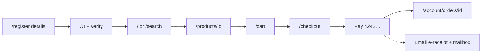
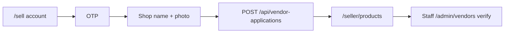
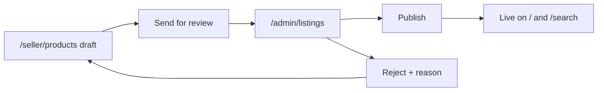
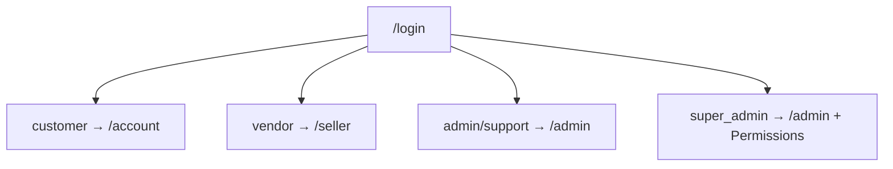

# Screen routing

Source of truth for Figma and walkthroughs. Paths match the Next.js app. Sidebar items are the primary nav; other URLs still work as deep links.

## Public storefront

| Screen | Route | Next |
| --- | --- | --- |
| Home | `/` | Browse, product, shop, sell, login |
| Search | `/search` | Product, cart |
| Shops index | `/shops` | Shop page |
| Shop page | `/shops/[slug]` | Product, cart |
| Product | `/products/[id]` | Cart, checkout |
| Cart | `/cart` | Checkout, search |
| Checkout | `/checkout` | OTP (guest) → pay → `/account/orders/[id]` |
| Reviews | `/reviews` | Product |
| About / Guide | `/about`, `/guide` | Home |
| Login | `/login?next=` | Role home or `next` |
| Register | `/register?next=` | OTP → `next` or `/` |
| Open a shop | `/sell` | Account OTP → shop + photo → `/seller/products` |

## Customer (`/account`)

| Screen | Route | Sidebar |
| --- | --- | --- |
| Overview | `/account` | Yes |
| Orders | `/account/orders` | Yes |
| Order detail | `/account/orders/[id]` | via Orders |
| Settings | `/account/settings` | Yes |
| Wishlist | `/account/wishlist` | Deep link / header |
| Messages | `/account/messages` | Deep link |
| Notifications | `/account/notifications` | Deep link |

## Seller (`/seller`)

| Screen | Route | Sidebar |
| --- | --- | --- |
| Overview | `/seller` | Yes |
| Products | `/seller/products` | Yes |
| Orders | `/seller/orders` | Yes |
| Discounts | `/seller/promotions` | Yes |
| Shop page | `/seller/storefront` | Yes |
| Payouts | `/seller/payouts` | Yes |
| Inventory | `/seller/inventory` | Deep link |
| Reports | `/seller/reports` | Deep link |
| Messages | `/seller/messages` | Deep link |
| Reviews | `/seller/reviews` | Deep link |

## Staff / owner (`/admin`)

| Screen | Route | Sidebar |
| --- | --- | --- |
| Overview | `/admin` | Yes |
| Shops | `/admin/vendors` | Yes |
| Publish | `/admin/listings` | Yes |
| Disputes | `/admin/disputes` | Yes |
| Growth | `/admin/reports` | Yes |
| Permissions | `/admin/roles` | Owner only |
| Products, categories, orders, customers, reviews, coupons, commissions, payouts, audit | `/admin/...` | Deep link |

## Primary user flows (for Figma frames)

### A. Register → buy → e-receipt

Guest checkout can start at `/checkout` and run register OTP inline before pay.

### B. Open a shop

### C. Listing maker-checker

### D. Role doors after login

## Auth API used by screens

| Step | Endpoint |
| --- | --- |
| Start register | `POST /api/auth/register` → challenge + optional `dev_code` |
| Verify OTP | `POST /api/auth/verify-email` → session cookie |
| Resend OTP | `POST /api/auth/resend-otp` |
| Login | `POST /api/auth/login` (blocks if `email_unverified`) |
| Open shop | `POST /api/vendor-applications` (multipart, `shop_image`) |
| Pay | `POST /api/checkout` then `POST /api/payments/{id}/confirm` → e-receipt mail |

## Local demo notes

- OTP and e-receipts write under `backend/private/mailbox/` when SMTP is off.
- Migration `0006_email_verification` adds `email_verified_at` and `email_challenges`.
- Demo accounts use password `demo` and are already verified.
