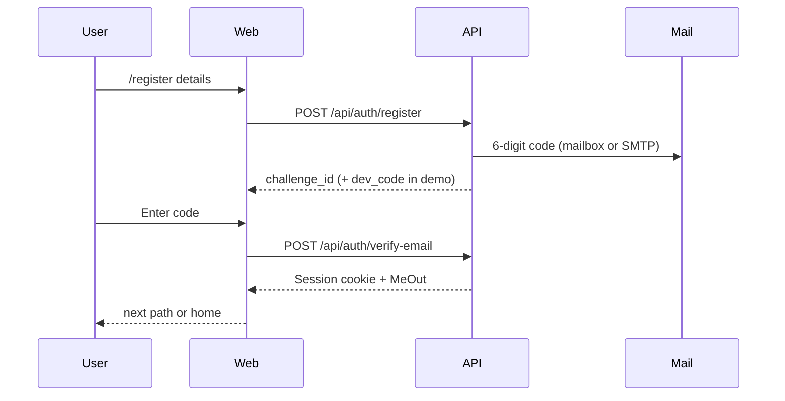
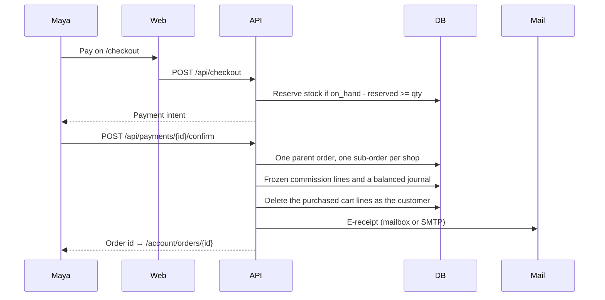
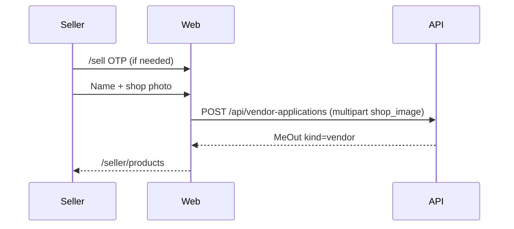
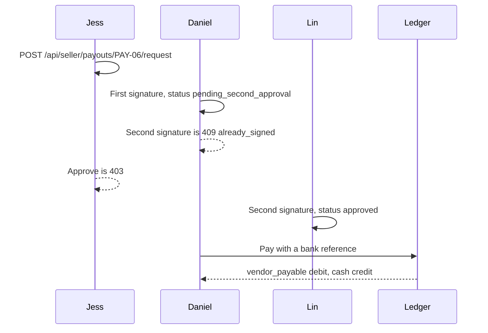

# Sequences

Screen routes for these flows: [screen-routing.md](screen-routing.md).

## Register with email OTP

Unverified accounts cannot `POST /api/auth/login` (`email_unverified`). Resend uses `POST /api/auth/resend-otp`.

## Split checkout (+ e-receipt)

Confirming the same intent again returns the same order. A declined test card releases the reservation and the coupon use. Mail failure never rolls back a successful payment.

## Open a shop with photo

## Two-person payout

An open dispute refuses a new request with `dispute_open` and leaves the held payout where it is.
