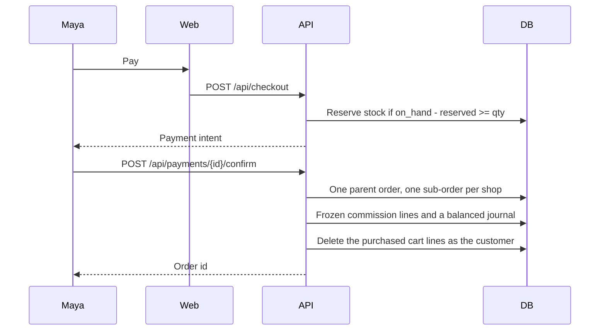
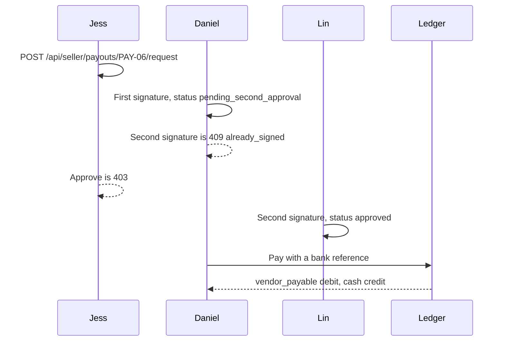

# Sequences

## Split checkout

Confirming the same intent again returns the same order. A declined test card releases the reservation and the coupon use.

## Two-person payout

An open dispute refuses a new request with `dispute_open` and leaves the held payout where it is.
