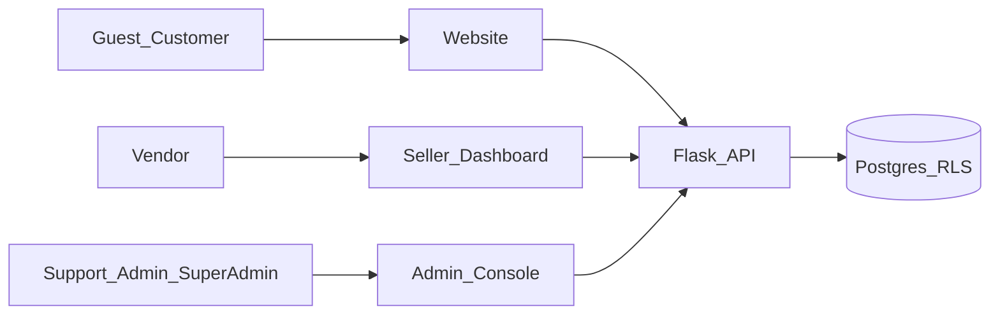

# System requirements — Bazaar

Bazaar is a multi-vendor marketplace: one public website, a Seller Dashboard, and an Admin Console. It is **not** Alibaba wholesale B2B and **not** a page-builder. The benchmark pattern is consumer marketplace ops (catalogue + seller workbench + staff console) with **maker-checker** on shop go-live, product go-live, and payouts.

## 1. Vision and surfaces

| Surface | Who | Purpose |
|---------|-----|---------|
| **Website (storefront)** | Guests, customers | Browse shops and products, cart, checkout, track orders |
| **Seller Dashboard** | Vendors | CRUD own catalogue, prices, stock, fulfil orders, request payouts |
| **Admin Console** | Support, Admin, Super Admin | Verify shops, moderate listings, disputes, commission, dual-sign payouts, roles |

## 2. Actors (roles)

Keep five system roles. Details and permission keys: [roles.md](roles.md).

| Role | Home | Maker or checker |
|------|------|------------------|
| Customer | `/account` | Buyer only |
| Vendor | `/seller` | Maker for shop docs, products, payout requests |
| Support | `/admin` | Checker for listings, reviews, disputes, payout signature |
| Admin | `/admin` | Checker for shops, listings, commission, payout signature |
| Super Admin | `/admin` | Admin + roles matrix, audit archive, demo reset |

## 3. Permission → operation matrix (CRUD-style)

Legend: C create · R read · U update · D delete/archive · A approve · X reject · S sign/submit.

| Resource | Customer | Vendor (own) | Support | Admin | Super Admin |
|----------|----------|--------------|---------|-------|-------------|
| Catalogue browse | R | R | R | R | R |
| Products | — | C R U D S | R A X | R U A X | + Admin |
| Inventory / price | — | U | R | U | + Admin |
| Shop / vendor | apply | U S | R | C R U A X | + Admin |
| Orders | C R (own) | R U ship (own) | R U | R U | + Admin |
| Coupons | apply | C R U D (shop) | R | C R U D | + Admin |
| Payouts | — | R S request | R S approve | R S approve | + Admin |
| Reviews | C R | R reply | R moderate | R moderate | + Admin |
| Roles / permissions | — | — | — | R | C R U D assign |
| Activity log | — | — | R export | R export | + archive |

## 4. Maker-checker rules

Maker and checker must be **different users**.

### Shop onboarding

`draft` → `under_review` (vendor submits) → `active` (staff verify) or `rejected` (staff reject). Permission: `vendor:verify`.

### Product listing

`draft` → `pending_review` (vendor submits) → `published` (staff approve) or `rejected` (staff reject).  
`published` → `pending_review` when title, price, or description changes.  
`published` / `rejected` → `archived` or back to `draft` for resubmit.  
Permission: `product:moderate` (Admin, Support). Storefront shows **published** only.

### Payouts

Vendor `payout:request` → two different staff with `payout:approve` → paid. Commission frozen at payment.

## 5. Business rules

- Tenant isolation via PostgreSQL RLS: cross-shop reads look like not found.
- Money in integer cents; rates in basis points.
- Commission copied onto the order at pay time; later rule edits do not rewrite history.
- Important create/update/delete/sign-in/deny writes an audit row; audit is append-only for the app DB role.
- No visual page-builder; storefront is fixed Next.js UI over marketplace data.

## 6. Demo flows

Password for every demo account: `demo`.

1. **Customer buy** — Maya shops two makers, pays with `4242…4242`, tracks sub-orders.
2. **Seller CRUD** — Jess edits price/stock, submits a listing if needed, ships her open order, requests payout.
3. **Listing maker-checker** — Jess (or seed) leaves a product in `pending_review`; Ava or Lin approves or rejects; only published appear on the website.
4. **Shop maker-checker** — Ava verifies SimplyCreativeJess after documents.
5. **Payout maker-checker** — Jess requests; Daniel signs; Lin signs; paid with a transfer reference.

Full walk-through: [setup-and-demo.md](setup-and-demo.md).

## 7. Tech we use

| Layer | Choice | Why |
|-------|--------|-----|
| Public web | Next.js (App Router) | One browser origin; storefront + dashboards; proxies `/api` |
| API | Flask + compat layer | REST, OpenAPI-style docs, role-scoped routers |
| Data | PostgreSQL + RLS | Tenant safety even if app filters are wrong |
| Auth | JWT cookie session | Same-site dashboards; staff behind login |
| Money | Integer cents | No float drift |
| Audit | Append-only log | Accountability for maker-checker |

Local: web `http://127.0.0.1:3000`, API `http://127.0.0.1:8000`. See repository README.
